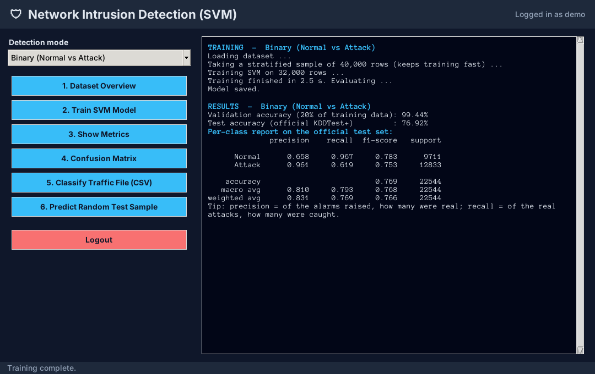

# Network Intrusion Detection System using SVM

A desktop application that detects malicious network connections using a **Support Vector Machine (SVM)** trained on the **NSL-KDD** benchmark dataset. It includes secure user login, a model-training dashboard, evaluation metrics and a tool that classifies your own traffic files.



## What it does
- Classifies a network connection as **Normal** or **Attack** (binary mode), or into **Normal / DoS / Probe / R2L / U2R** (multi-class mode).
- Trains an SVM in a few seconds and shows accuracy, precision, recall, F1 and a confusion matrix.
- Classifies a whole CSV of connections (`data/sample_traffic.csv` is included for a demo).
- User registration and login with **salted + hashed passwords** (SQLite).

## Dataset
[NSL-KDD](https://www.unb.ca/cic/datasets/nsl.html) - an improved version of the KDD'99 intrusion dataset. Each row is one network connection described by 41 features (protocol, service, bytes transferred, error rates, login info, ...).

| Category | Meaning | Train rows | Test rows |
|---|---|---:|---:|
| Normal | legitimate traffic | 67,343 | 9,711 |
| DoS | flooding a server so it stops responding | 45,927 | 7,460 |
| Probe | scanning the network for weaknesses | 11,656 | 2,421 |
| R2L | outsider tries to gain local access (password guessing...) | 995 | 2,885 |
| U2R | normal user tries to become admin | 52 | 67 |

The official test set contains 17 attack types that never appear in training, which makes it a realistic (and hard) test.

## How it works
```
raw connection (41 features)
   -> one-hot encode protocol / service / flag      (text -> numbers)
   -> standardise the numeric features              (SVM needs scaled data)
   -> SVM with RBF kernel (C=10)
   -> Normal / Attack   (or Normal / DoS / Probe / R2L / U2R)
```
Preprocessing and the SVM live in a single scikit-learn `Pipeline`, so training and prediction always use identical preprocessing.

## Results
Trained on a 40,000-row stratified sample (32,000 rows to fit, 8,000 for validation) and evaluated on the **official, separate** test set (KDDTest+):

| Mode | Validation accuracy | Official test accuracy |
|---|---:|---:|
| Binary (Normal vs Attack) | 99.4% | 76.9% |
| Multi-class (5 classes) | 98.4% | 76.1% |

**Comparison with other algorithms (binary, official test set):**

| Model | Test accuracy | Attack precision | Attack recall | Attack F1 |
|---|---:|---:|---:|---:|
| **SVM (RBF kernel)** | **0.769** | 0.961 | 0.619 | **0.753** |
| SVM (Linear) | 0.751 | 0.916 | 0.619 | 0.739 |
| Logistic Regression | 0.753 | 0.917 | 0.622 | 0.742 |
| Random Forest | 0.764 | 0.967 | 0.606 | 0.745 |

All rows (and the binary row in the first table) use the **same 32,000 training rows and the same official test set**, so the SVM figures agree: 76.9% accuracy, 0.961 / 0.619 / 0.753 attack precision / recall / F1. The models are close to each other (within about 2 points); the RBF SVM has the best accuracy and F1, while Logistic Regression is marginally ahead on attack recall.

**Honest observations**
- Validation accuracy (~99%) is much higher than test accuracy (~77%) because the test set includes attack types the model has never seen. Reporting the test number is the realistic one.
- When the model says "Attack" it is almost always right (precision ~96%), but it misses about 38% of attacks in the test set (recall ~62%).
- Rare classes (R2L, U2R) are the hardest: there are very few training examples. See `docs/confusion_matrix_multi.png`.

## Setup
```bash
git clone <your-repo-url>
cd <repo-folder>
pip install -r requirements.txt
python download_data.py        # downloads NSL-KDD into data/ (one time)
python app.py                  # starts the desktop app
```
Requires Python 3.9+ (Tkinter ships with the standard Python installer; on Ubuntu: `sudo apt install python3-tk`).

**Using the app:** Register -> Login -> *Dataset Overview* -> *Train SVM Model* -> *Show Metrics* / *Confusion Matrix* -> *Classify Traffic File* and choose `data/sample_traffic.csv`.

**Without the GUI:** `python train_model.py --mode both --compare` trains everything, prints reports and saves charts into `docs/`. Use `--sample 0` to train on all 125,973 rows (about 2 minutes, slightly higher accuracy).

## Project structure
```
app.py              Tkinter GUI (login, register, dashboard)
train_model.py      command-line training + algorithm comparison
download_data.py    downloads the NSL-KDD dataset
nids/data_utils.py  column names, attack grouping, file loading
nids/model.py       pipeline, SVM training, evaluation, plotting
nids/auth.py        SQLite user accounts with hashed passwords
data/sample_traffic.csv   34 sample connections for the demo
docs/               confusion matrices, screenshots, comparison table
```

## Limitations and future work
- Works on pre-extracted connection features, not live packet capture. A next step is extracting these features from real traffic (e.g. with Zeek or CICFlowMeter).
- Improve recall on rare attacks with resampling (SMOTE) or cost-sensitive learning; try newer datasets (CIC-IDS2017).
- Add a web dashboard (Streamlit/Flask) and real-time alerts.

## Tech stack
Python, scikit-learn (SVM), pandas, NumPy, matplotlib, Tkinter, SQLite.
